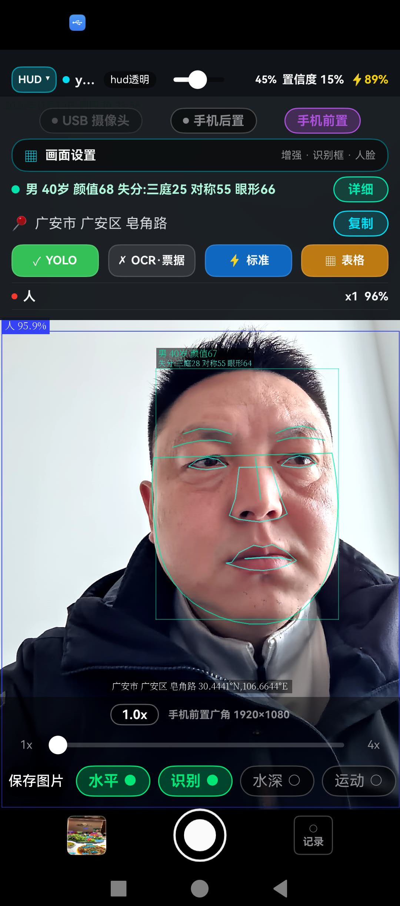
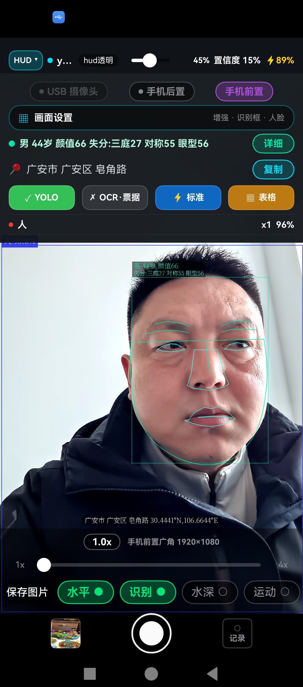
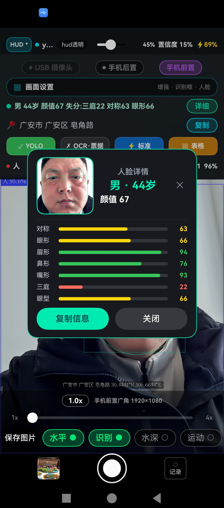
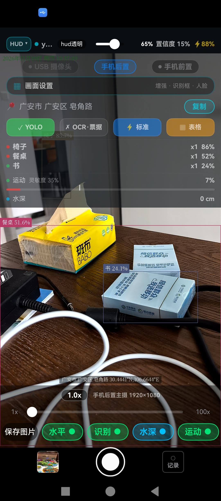

# HmFish — 鸿蒙智能探鱼相机 / Smart Fishing Camera for HarmonyOS

**中文**

HmFish 是一款运行于 HarmonyOS NEXT 的智能钓鱼摄像头应用。它将 USB 水下探鱼摄像头（UVC）与手机前后摄像头统一接入，内置多套端侧 AI 模型：YOLO 目标检测（通用 80 类 + 淡水鱼 21 种）、人脸识别分析（106 关键点 + 性别/年龄/颜值评分）、OCR 文字与表格识别、AI 超分辨率增强，并提供运动检测自动录像、水深估算、语音播报、能耗档位等实用功能。全部推理在设备本地完成，无需联网，不依赖云端。

**English**

HmFish is a smart fishing-camera app for HarmonyOS NEXT. It unifies USB underwater fishing cameras (UVC) with the phone's front/rear cameras, and ships with multiple on-device AI models: YOLO object detection (80 general classes + 21 freshwater-fish species), face analysis (106 landmarks + gender/age/beauty scoring), OCR for text and tables, and AI super-resolution enhancement — plus motion-triggered auto recording, water-depth estimation, voice broadcast, and power presets. All inference runs locally on the device; no network or cloud service is required.

---

## 功能总览 / Feature Overview

| 功能 / Feature | 说明 / Description |
|---|---|
| 多相机接入 / Multi-camera input | USB UVC 摄像头（探鱼器）+ 手机前置/后置，一键切换，断连自动恢复 / USB UVC camera (fish finder) + phone front/rear, one-tap switching, auto-recovery on disconnect |
| AI 目标检测 / AI object detection | 双模型可切换：YOLO 26M（80 类）与 Fish M（21 种淡水鱼），识别框 + 计数标签 + 按类别自动录像 / Switchable dual models: YOLO 26M (80 classes) and Fish M (21 freshwater species), boxes + count labels + category-based auto recording |
| 人脸识别分析 / Face analysis | SCRFD 检测 + 106 关键点连线框 + 性别/年龄/颜值（0~100，7 分项），多脸同屏，点击识别框弹出详情面板 / SCRFD detection + 106-point wireframe + gender/age/beauty (0–100, 7 sub-scores), multiple faces, tap a face box to open the detail panel |
| OCR 文字识别 / OCR | PP-OCRv4/v5 检测+识别+方向分类，PP-Structure 表格识别，结果弹窗一键复制 / PP-OCRv4/v5 detect + recognize + orientation classification, PP-Structure table recognition, one-tap copy from the result popup |
| AI 超分增强 / AI super-resolution | QuickSRNetMedium ×4 细节注入 + 双重锐化（USB 画面），或非 AI 的亮度/锐度/对比度/饱和度调节 / QuickSRNetMedium ×4 detail injection + double sharpening (USB), or non-AI brightness/sharpness/contrast/saturation |
| 录像与拍照 / Recording & capture | 手动录像/拍照、定时录像、运动检测自动录像、识别类别自动录像、自定义触发音效 / Manual record/capture, timed recording, motion-triggered and detection-triggered auto recording, custom trigger sound |
| 运动检测 / Motion detection | 灵敏度可调；画面运动超阈值时 HUD 标红并自动录像 / Adjustable sensitivity; HUD highlights red and auto-records when motion exceeds the threshold |
| 水深估算 / Depth estimation | 入水→触底过程估算水深：水体特征确认 + 浑浊度/摄像头重量参数 + 数据线阻力减速模型 / Estimates depth during descent: water-feature confirmation + turbidity/camera-weight parameters + cable-drag deceleration model |
| HUD 信息栏 / HUD | 可折叠、透明度可调；模型名、相机信息、电池电量、位置地名、人脸行、录像计时 / Collapsible with adjustable opacity; model name, camera info, battery, place name, face rows, record timer |
| 语音播报 / Voice broadcast | 按钮操作与识别结果 TTS 播报（如"识别到草鱼3条、鲫鱼1条"），音量可调 / TTS for button actions and detection results (e.g. "3 crucian carp, 1 common carp"), adjustable volume |
| 能耗档位 / Power presets | 省电/平衡/性能三档（处理间隔），适合长时间挂机 / Power-saver / balanced / performance presets (processing interval) for long sessions |
| 捏合变焦 / Pinch zoom | 预览区双指捏合调焦（硬件变焦），倍数持久化 / Two-finger pinch on the preview adjusts (hardware) zoom; the ratio persists |

---

## AI 能力详解 / AI Capabilities in Depth

### 内置模型 / Bundled Models

| 模型 / Model | 格式 / Format | 大小 / Size | 用途 / Purpose |
|---|---|---|---|
| yolo26m_640 | NCNN | 78 MB | 通用目标检测，80 类（人/车/动物/日用品等，COCO 类别）/ General object detection, 80 classes (people, vehicles, animals, everyday items — COCO) |
| fishm_640 | NCNN | 36 MB | 淡水鱼检测，21 种（鲫鱼、鲤鱼、草鱼、鲢鱼、鳙鱼、青鱼、鲶鱼、黑鱼、黄颡鱼、罗非鱼、中华倒刺鲃、江团、马口鱼、翘嘴、溪石斑、泥鳅、白条、鳑鲏、麦穗鱼、虾虎鱼、食蚊鱼）/ Freshwater-fish detection, 21 species |
| det_500m | ONNX | 2.4 MB | SCRFD 人脸检测 / SCRFD face detection |
| 2d106det | ONNX | 4.8 MB | 106 点人脸关键点 / 106-point face landmarks |
| genderage | ONNX | 1.3 MB | 性别 + 年龄估计 / Gender + age estimation |
| ch_PP-OCRv4 / v5 det + rec + cls | ONNX | 4.5–15.9 MB | 文字检测、方向分类、文字识别 / Text detection, orientation classification, recognition |
| ch_ppstructure_mobile_v2_SLANet | ONNX | 7.4 MB | 表格结构识别 / Table structure recognition |
| quicksrnetmedium | ONNX | 0.3 MB | AI 超分辨率（×4）/ AI super-resolution (×4) |

### 目标检测流水线 / Object-Detection Pipeline

**中文** 视频帧经 libyuv 转 RGBA 后进入 C++ 检测线程：letterbox 缩放到 640×640 → NCNN 前向 → NMS 去重 → 坐标逆映射回原图。识别结果以半透明彩框 + "类别 ×N" 计数标签叠加在预览上；HUD 显示实时统计。置信度阈值（5%~95%）与语音播报可在"识别设置"中调节；勾选特定类别后，画面中出现该类别会自动触发录像并保存到相册。

**English** Frames are converted to RGBA via libyuv and fed to the native detection thread: letterbox to 640×640 → NCNN forward pass → NMS → inverse mapping back to the frame. Results are drawn as translucent colored boxes with "class ×N" count labels; the HUD shows live statistics. The confidence threshold (5%–95%) and voice broadcast are adjustable in Detection Settings; selected categories can trigger automatic recording to the gallery.

### 人脸识别与颜值评分 / Face Recognition & Beauty Scoring

**中文** 人脸链路为三级流水线：SCRFD 检测（det_500m）→ 106 关键点回归（2d106det）→ 性别/年龄估计（genderage，滑动投票 + 7 样本中值滤波，校准年龄偏移）。颜值评分基于面部比例几何学，由 7 个分项加权合成（0~100）：对称性（关键点镜像对到中轴距离）、眼形（眼宽/双眼距）、眉形（眉眼距比 + 左右对称）、鼻形（鼻宽比）、嘴形（嘴宽比）、三庭（眼中线-鼻基线/鼻基线-下巴，理想比 0.74）、眼型（眼睛开合比）。关键点越界或被遮挡时以 NaN 标记，绘制跳段、评分回退，避免错误直线与分数污染。多张人脸各配独立配色，HUD 每人行显示性别/年龄/颜值/失分项；点击识别框弹出详情面板：实时头像裁剪、7 分项彩色进度条、面板到人脸的跟随箭头，分值随画面 250ms 轮询实时刷新。

**English** The face pipeline has three stages: SCRFD detection (det_500m) → 106-landmark regression (2d106det) → gender/age estimation (genderage, with sliding vote + 7-sample median filter and age-offset calibration). The beauty score is geometry-based, a weighted blend of seven sub-scores (0–100): symmetry (mirror-pair distances to the facial axis), eye shape (eye width / inter-pupillary distance), brow shape (brow-eye gap ratio + left/right symmetry), nose shape (nose-width ratio), mouth shape (mouth-width ratio), facial thirds (eye-line→nose-base / nose-base→chin, ideal 0.74), and eye aspect (open/closed ratio). Out-of-bounds or occluded landmarks are marked NaN — skipped during drawing and fallen back during scoring, preventing stray lines and score contamination. Each face gets its own color; the HUD shows one row per face with gender/age/beauty/weakest sub-scores. Tapping a face box opens a detail panel with a live cropped avatar, seven colored score bars, and a tracking arrow from the panel to the face; scores refresh every 250 ms.

### OCR 与表格识别 / OCR & Table Recognition

**中文** 采用 PaddleOCR 移动端模型（PP-OCRv4 / PP-OCRv5 可切换）：文本检测 → 方向分类 → 识别（中英文 + 数字，内置词典）。表格模式使用 PP-Structure SLANet 还原表格结构，结果以 HTML 表格弹窗展示，支持一键复制。方向分类模型（textline_ori_cls）保证旋转文本也能正确识别。

**English** Built on PaddleOCR mobile models (PP-OCRv4 / PP-OCRv5 switchable): text detection → orientation classification → recognition (Chinese, English, digits, with bundled dictionaries). Table mode uses PP-Structure SLANet to rebuild table structure, shown as an HTML-style popup with one-tap copy. The orientation-classification model (textline_ori_cls) ensures rotated text is recognized correctly.

### AI 超分辨率（USB 画面）/ AI Super-Resolution (USB)

**中文** USB 摄像头画面支持三档增强：关闭（原始画面）、非 AI（亮度/锐度/对比度/饱和度实时调节，不占用 AI 算力）、AI 超分（QuickSRNetMedium ×4 细节注入：原图细节零损失 + AI 生成细节按强度叠加 + 双重锐化）。过慢时自动降档保持流畅。

**English** The USB camera feed supports three enhancement modes: off (raw), non-AI (real-time brightness/sharpness/contrast/saturation, no AI cost), and AI super-resolution (QuickSRNetMedium ×4 detail injection: zero loss of original detail + AI-generated detail blended by strength + double sharpening). It automatically steps down if processing falls behind.

### 性能设计 / Performance Design

**中文** 全部视觉处理在 C++ 层完成（libyuv 色彩转换、NCNN/ONNX Runtime 推理、OpenCV 辅助），ArkTS 层只负责 UI 与状态。检测在独立工作线程运行，采用"永远处理最新帧"的跳帧策略，避免排队积压；多模型推理互不阻塞。相机占用带 3 秒超时保护，防止异常释放卡死。能耗档位通过调节处理间隔平衡续航与流畅度。

**English** All vision processing happens in C++ (libyuv color conversion, NCNN/ONNX Runtime inference, OpenCV helpers); the ArkTS layer only handles UI and state. Detection runs on a dedicated worker thread with an always-newest-frame skipping policy to avoid backlog; multiple models run without blocking each other. Camera occupancy has a 3-second timeout guard against release deadlocks. Power presets trade battery for smoothness by adjusting the processing interval.

---

## 运行截图 / Screenshots

| 主界面 / Main screen | 人脸识别 / Face wireframe |
|---|---|
|  |  |

| 人脸详情 / Face detail | 目标检测 / Object detection |
|---|---|
|  |  |

---

## 安装 / Install

**中文**

1. 从 [Releases](https://github.com/AnDouDou188188/HmFish/releases) 下载最新的 `HmFish_*.hap`（已签名）。
2. 将设备开启开发者模式（设置 → 关于 → 连点版本号 → 开发者选项 → USB 调试）。
3. 连接电脑后执行：
   ```
   hdc install -r HmFish_xxxxxxxx.hap
   ```
   或直接将 hap 发送到手机，用系统文件管理器点击安装（需开启"允许安装未知来源应用"）。
4. 系统要求：HarmonyOS 6.1.1（API 24）及以上。首次启动需授予相机、麦克风、位置权限。

**English**

1. Download the latest signed `HmFish_*.hap` from [Releases](https://github.com/AnDouDou188188/HmFish/releases).
2. Enable developer mode on the device (Settings → About → tap build number repeatedly → Developer options → USB debugging).
3. With the device connected, run:
   ```
   hdc install -r HmFish_xxxxxxxx.hap
   ```
   Or send the hap to the phone and install it from the file manager ("install from unknown sources" must be allowed).
4. Requires HarmonyOS 6.1.1 (API 24) or later. Grant camera, microphone, and location permissions on first launch.

---

## 从源码构建 / Build from Source

**中文**

1. 安装 [DevEco Studio](https://developer.huawei.com/consumer/cn/deveco-studio/)（5.0+，含 HarmonyOS SDK，targetSdk 26.0.0 / compatibleSdk 6.1.1）。
2. 克隆本仓库并用 DevEco Studio 打开根目录。
3. 连接真机（需已在开发者选项中允许 USB 调试与 USB 安装），配置自动签名（File → Project Structure → Signing Configs）。
4. 点击 Run，或命令行：
   ```
   hvigorw assembleHap
   ```
   产物位于 `entry/build/default/outputs/default/entry-default-signed.hap`。

**English**

1. Install [DevEco Studio](https://developer.huawei.com/consumer/cn/deveco-studio/) (5.0+, with the HarmonyOS SDK; targetSdk 26.0.0 / compatibleSdk 6.1.1).
2. Clone this repo and open the root folder in DevEco Studio.
3. Connect a real device (USB debugging + USB install allowed in developer options) and configure automatic signing (File → Project Structure → Signing Configs).
4. Press Run, or from the command line:
   ```
   hvigorw assembleHap
   ```
   The artifact is at `entry/build/default/outputs/default/entry-default-signed.hap`.

---

## 项目结构 / Project Structure

```
entry/src/main/
├── cpp/                      # C++ 视觉层 / native vision layer
│   ├── FaceNet.cpp           # SCRFD + 106 关键点 + 性别年龄 + 颜值评分
│   ├── yuv_pipeline.cpp      # libyuv 色彩转换、绘制叠加、人脸工作线程、水深估算
│   ├── OcrBridge.cpp         # OCR / YOLO / 模型调度桥接
│   ├── napi_init.cpp         # NAPI 导出（帧捕获、人脸信息、设置项）
│   └── third_party/          # onnxruntime / ncnn / opencv / libyuv
├── ets/
│   ├── pages/Index.ets       # 主页面：预览、HUD、弹层、手势
│   ├── view/                 # HUD、底部面板、各设置 Sheet、结果弹窗
│   ├── camera/               # 手机相机 / UVC 相机 / 录像服务
│   ├── common/               # 模型管理、TTS、电源、设置持久化、USB 扫描
│   └── core/                 # 媒体控制、定位服务、视觉控制器
└── resources/rawfile/        # 内置模型与词典 / bundled models & dictionaries
```

---

## 权限说明 / Permissions

| 权限 / Permission | 用途 / Purpose |
|---|---|
| ohos.permission.CAMERA | 相机预览与录像 / Camera preview and recording |
| ohos.permission.MICROPHONE | 录像采集声音 / Audio for recordings |
| ohos.permission.LOCATION / APPROXIMATELY_LOCATION | HUD 显示位置地名 / Place name in the HUD |
| ohos.permission.INTERNET | OCR/模型可选在线词典通道 / Optional online dictionary channel |

---

## 许可 / License

本项目仅供学习交流使用，内置模型版权归各自所有者。/ This project is for learning purposes; bundled models belong to their respective owners.
